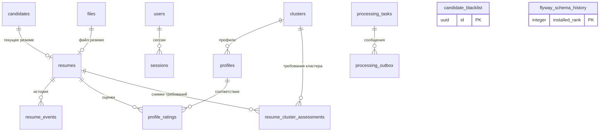

# Текущая схема PostgreSQL

Снимок работающей БД `hr_dam` на 9 ноября 2026 года, после объединения сегодняшних изменений в **V7**.
Всего 14 таблиц: 13 прикладных и служебная `flyway_schema_history`.
Сведения получены из системного каталога PostgreSQL, без выгрузки пользовательских данных.

## Связи

На схеме показаны реальные внешние ключи. `o|` означает «ноль или одна запись»,
`o{` — «ноль или несколько», `||` — «ровно одна».

- У кандидата может быть не более одного текущего резюме; файл тоже связан не более чем с одним резюме.
- Чёрный список сопоставляется по контактам и ФИО, внешнего ключа на кандидата нет.
- В `processing_tasks.state` хранится состояние задания в JSON. Прямых внешних ключей из этой таблицы на сотрудников, кандидатов или резюме нет.
- `resume_events.actor_id` и `recipient_id` имеют тип UUID, но внешних ключей на `users` сейчас нет.
- Гостевые задания и отчёты хранятся во временном S3-хранилище и в эту БД не записываются.

## Таблицы и поля

`NULL` отмечен только там, где отсутствие значения разрешено. Ограничения и индексы приведены после полей каждой таблицы.

### `candidates`

Кандидаты и происхождение контактных данных.

| Поле | Тип | NULL | По умолчанию |
| --- | --- | --- | --- |
| `id` | `uuid` | — | — |
| `phone` | `character varying(20)` | да | — |
| `last_name` | `character varying(100)` | да | — |
| `first_name` | `character varying(100)` | да | — |
| `middle_name` | `character varying(100)` | да | — |
| `created_at` | `timestamp with time zone` | — | — |
| `updated_at` | `timestamp with time zone` | — | — |
| `contact_provenance` | `jsonb` | — | `'{}'::jsonb` |

Ограничения:

- `UNIQUE (phone)`
- `PRIMARY KEY (id)`

Дополнительные индексы:

- `CREATE INDEX candidates_normalized_name_idx ON public.candidates USING btree (lower(replace((last_name)::text, 'ё'::text, 'е'::text)), lower(replace((first_name)::text, 'ё'::text, 'е'::text)), lower(replace((COALESCE(middle_name, ''::character varying))::text, 'ё'::text, 'е'::text)))`

### `files`

Метаданные файлов и их адреса в S3; сами байты хранятся вне PostgreSQL.

| Поле | Тип | NULL | По умолчанию |
| --- | --- | --- | --- |
| `id` | `uuid` | — | — |
| `bucket` | `character varying(255)` | — | — |
| `object_key` | `text` | — | — |
| `file_name` | `text` | — | — |
| `mime_type` | `character varying(100)` | да | — |
| `size_bytes` | `bigint` | да | — |
| `file_sha256` | `character(64)` | да | — |
| `created_at` | `timestamp with time zone` | — | — |

Ограничения:

- `UNIQUE (bucket, object_key)`
- `PRIMARY KEY (id)`

### `resumes`

Текущее резюме кандидата, статус отбора и статус оценки.

| Поле | Тип | NULL | По умолчанию |
| --- | --- | --- | --- |
| `id` | `uuid` | — | — |
| `candidate_id` | `uuid` | — | — |
| `file_id` | `uuid` | — | — |
| `status` | `character varying(20)` | — | — |
| `scoring_status` | `character varying(20)` | — | — |
| `created_at` | `timestamp with time zone` | — | — |
| `updated_at` | `timestamp with time zone` | — | — |
| `contact_extraction` | `jsonb` | да | — |

Ограничения:

- `FOREIGN KEY (candidate_id) REFERENCES candidates(id)`
- `UNIQUE (candidate_id)`
- `FOREIGN KEY (file_id) REFERENCES files(id)`
- `UNIQUE (file_id)`
- `PRIMARY KEY (id)`
- `CHECK (((scoring_status)::text = ANY ((ARRAY['pending'::character varying, 'processing'::character varying, 'completed'::character varying, 'failed'::character varying])::text[])))`
- `CHECK (((status)::text = ANY ((ARRAY['in_work'::character varying, 'in_process'::character varying, 'historical'::character varying])::text[])))`

Дополнительные индексы:

- `CREATE INDEX resumes_scoring_queue_idx ON public.resumes USING btree (scoring_status, updated_at)`

### `resume_events`

История загрузки, замены, оценки и изменения статуса резюме.

| Поле | Тип | NULL | По умолчанию |
| --- | --- | --- | --- |
| `id` | `uuid` | — | — |
| `resume_id` | `uuid` | — | — |
| `event_type` | `character varying(50)` | — | — |
| `actor_id` | `uuid` | да | — |
| `recipient_id` | `uuid` | да | — |
| `message` | `text` | да | — |
| `created_at` | `timestamp with time zone` | — | — |
| `analysis_duration_ms` | `integer` | да | — |

Ограничения:

- `CHECK ((analysis_duration_ms >= 0))`
- `CHECK (((event_type)::text = ANY ((ARRAY['uploaded'::character varying, 'replaced'::character varying, 'replacement_rejected'::character varying, 'scored'::character varying, 'scoring_failed'::character varying, 'status_changed'::character varying, 'contacts_recovered'::character varying])::text[])))`
- `PRIMARY KEY (id)`
- `FOREIGN KEY (resume_id) REFERENCES resumes(id)`

Дополнительные индексы:

- `CREATE INDEX resume_events_resume_created_idx ON public.resume_events USING btree (resume_id, created_at)`

### `clusters`

Кластеры направлений подбора.

| Поле | Тип | NULL | По умолчанию |
| --- | --- | --- | --- |
| `id` | `uuid` | — | — |
| `name` | `character varying(255)` | — | — |
| `track` | `character varying(20)` | — | — |
| `comment` | `text` | да | — |
| `is_active` | `boolean` | — | `true` |

Ограничения:

- `PRIMARY KEY (id)`

### `profiles`

Профили должностей и требования к кандидатам.

| Поле | Тип | NULL | По умолчанию |
| --- | --- | --- | --- |
| `id` | `uuid` | — | — |
| `cluster_id` | `uuid` | — | — |
| `position_name` | `character varying(255)` | — | — |
| `education` | `text` | да | — |
| `experience` | `text` | да | — |
| `keywords` | `text[]` | да | — |
| `stop_factors` | `text[]` | да | — |
| `comment` | `text` | да | — |
| `is_active` | `boolean` | — | `true` |

Ограничения:

- `FOREIGN KEY (cluster_id) REFERENCES clusters(id)`
- `PRIMARY KEY (id)`

Дополнительные индексы:

- `CREATE INDEX profiles_cluster_id_idx ON public.profiles USING btree (cluster_id)`

### `profile_ratings`

Оценка соответствия резюме конкретному профилю.

| Поле | Тип | NULL | По умолчанию |
| --- | --- | --- | --- |
| `id` | `uuid` | — | — |
| `resume_id` | `uuid` | — | — |
| `profile_id` | `uuid` | — | — |
| `score` | `numeric(5,2)` | — | — |
| `matched_keywords` | `jsonb` | да | — |
| `triggered_stop_factors` | `jsonb` | да | — |
| `details` | `jsonb` | да | — |
| `explanation` | `text` | да | — |
| `calculated_at` | `timestamp with time zone` | — | — |

Ограничения:

- `PRIMARY KEY (id)`
- `FOREIGN KEY (profile_id) REFERENCES profiles(id)`
- `FOREIGN KEY (resume_id) REFERENCES resumes(id)`
- `UNIQUE (resume_id, profile_id)`
- `CHECK (((score >= (0)::numeric) AND (score <= (100)::numeric)))`

### `resume_cluster_assessments`

Снимок требований кластера на момент оценки резюме.

| Поле | Тип | NULL | По умолчанию |
| --- | --- | --- | --- |
| `resume_id` | `uuid` | — | — |
| `cluster_id` | `uuid` | — | — |
| `requirements` | `jsonb` | — | — |
| `assessed_at` | `timestamp with time zone` | — | `now()` |

Ограничения:

- `FOREIGN KEY (cluster_id) REFERENCES clusters(id) ON DELETE CASCADE`
- `PRIMARY KEY (resume_id, cluster_id)`
- `FOREIGN KEY (resume_id) REFERENCES resumes(id) ON DELETE CASCADE`

### `candidate_blacklist`

Чёрный список: контакты, организация и признак активности.

| Поле | Тип | NULL | По умолчанию |
| --- | --- | --- | --- |
| `id` | `uuid` | — | — |
| `phone` | `character varying(20)` | — | — |
| `last_name` | `character varying(100)` | — | — |
| `first_name` | `character varying(100)` | — | — |
| `middle_name` | `character varying(100)` | да | — |
| `company_name` | `character varying(255)` | — | — |
| `is_active` | `boolean` | — | `true` |

Ограничения:

- `PRIMARY KEY (id)`

Дополнительные индексы:

- `CREATE INDEX candidate_blacklist_active_identity_idx ON public.candidate_blacklist USING btree (phone, last_name, first_name, middle_name) WHERE (is_active = true)`

### `users`

Учётные записи сотрудников; пароли представлены хешами.

| Поле | Тип | NULL | По умолчанию |
| --- | --- | --- | --- |
| `id` | `uuid` | — | — |
| `login` | `character varying(255)` | — | — |
| `display_name` | `character varying(255)` | — | — |
| `password_hash` | `text` | — | — |
| `is_active` | `boolean` | — | `true` |
| `created_at` | `timestamp with time zone` | — | `now()` |

Ограничения:

- `UNIQUE (login)`
- `PRIMARY KEY (id)`

### `sessions`

Сессии сотрудников, сроки действия и отзыв.

| Поле | Тип | NULL | По умолчанию |
| --- | --- | --- | --- |
| `id` | `uuid` | — | — |
| `user_id` | `uuid` | — | — |
| `expires_at` | `timestamp with time zone` | — | — |
| `revoked_at` | `timestamp with time zone` | да | — |
| `created_at` | `timestamp with time zone` | — | `now()` |

Ограничения:

- `PRIMARY KEY (id)`
- `FOREIGN KEY (user_id) REFERENCES users(id)`

Дополнительные индексы:

- `CREATE INDEX sessions_expiry ON public.sessions USING btree (expires_at)`

### `processing_tasks`

Постоянное состояние заданий авторизованного режима.

| Поле | Тип | NULL | По умолчанию |
| --- | --- | --- | --- |
| `id` | `uuid` | — | — |
| `state` | `jsonb` | — | — |
| `version` | `bigint` | — | `1` |
| `created_at` | `timestamp with time zone` | — | `now()` |

Ограничения:

- `PRIMARY KEY (id)`
- `CHECK (((state ->> 'mode'::text) = 'authorized'::text))`

### `processing_outbox`

Сообщения, которые нужно надёжно передать в RabbitMQ.

| Поле | Тип | NULL | По умолчанию |
| --- | --- | --- | --- |
| `id` | `uuid` | — | — |
| `task_id` | `uuid` | — | — |
| `message` | `jsonb` | — | — |
| `published_at` | `timestamp with time zone` | да | — |
| `created_at` | `timestamp with time zone` | — | `now()` |

Ограничения:

- `PRIMARY KEY (id)`
- `FOREIGN KEY (task_id) REFERENCES processing_tasks(id)`

Дополнительные индексы:

- `CREATE INDEX processing_outbox_pending ON public.processing_outbox USING btree (created_at) WHERE (published_at IS NULL)`

### `flyway_schema_history`

Служебная история применения миграций.

| Поле | Тип | NULL | По умолчанию |
| --- | --- | --- | --- |
| `installed_rank` | `integer` | — | — |
| `version` | `character varying(50)` | да | — |
| `description` | `character varying(200)` | — | — |
| `type` | `character varying(20)` | — | — |
| `script` | `character varying(1000)` | — | — |
| `checksum` | `integer` | да | — |
| `installed_by` | `character varying(100)` | — | — |
| `installed_on` | `timestamp without time zone` | — | `now()` |
| `execution_time` | `integer` | — | — |
| `success` | `boolean` | — | — |

Ограничения:

- `PRIMARY KEY (installed_rank)`

Дополнительные индексы:

- `CREATE INDEX flyway_schema_history_s_idx ON public.flyway_schema_history USING btree (success)`

## Изменение схемы

Схема изменяется миграциями в [db/migrations](../db/migrations). Этот документ — снимок текущего состояния, а не SQL-миграция.
