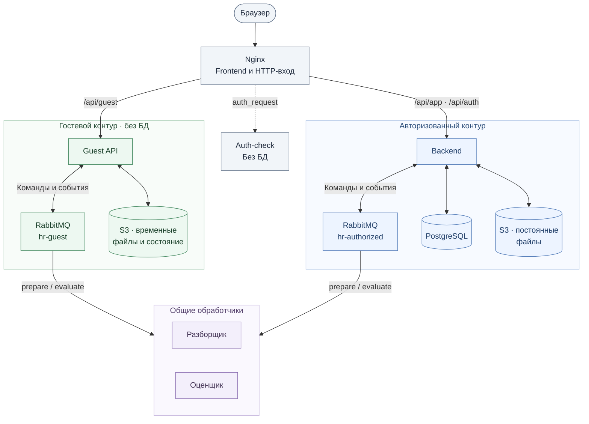
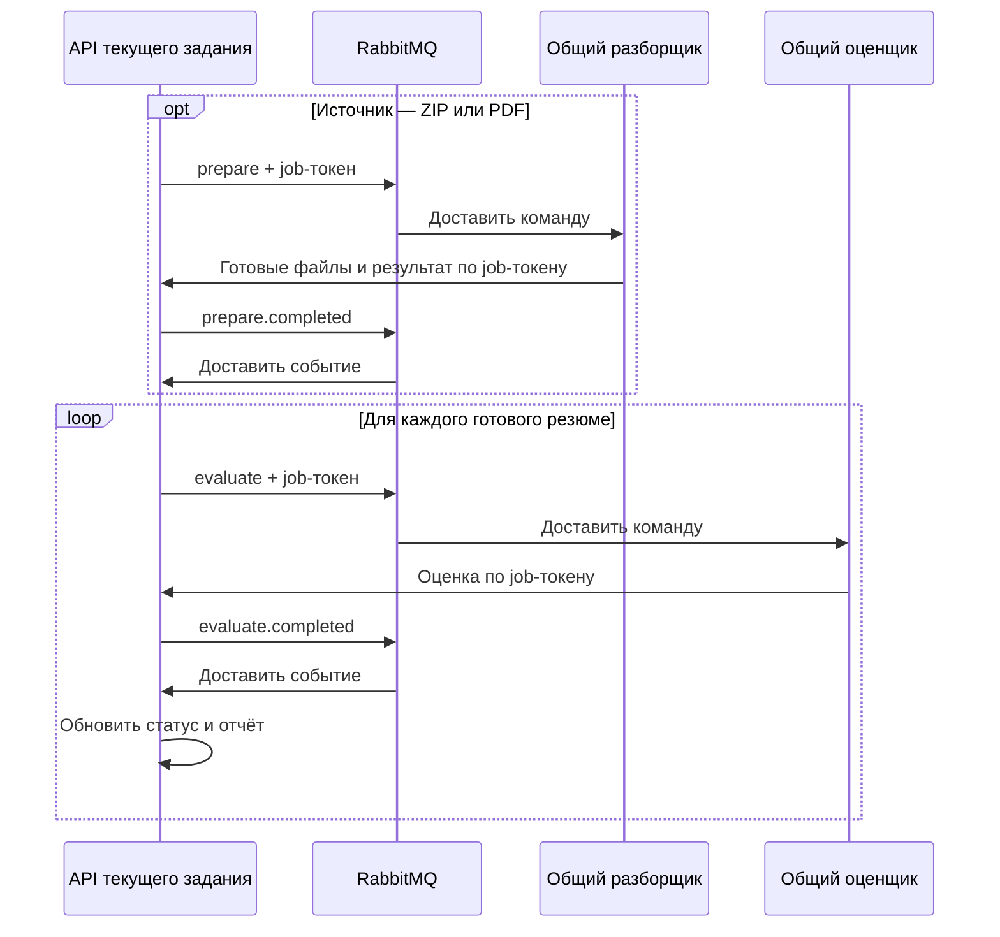

# Целевая архитектура приложения

Дата: 6 ноября 2026 года. Статус на 9 ноября: API, авторизация, хранение, оркестрация, frontend и эксплуатационная конфигурация реализованы. Образы разборщика/оценщика ожидаются из другой ветки.

Документы: [гостевые данные и их удаление](guest-task-lifecycle.md), [контракты разборщика и оценщика](processing-services-contract.md), [план реализации](implementation-plan.md). Существующий код описан в [текущей архитектуре](architecture.md).

Документ описывает единую архитектуру всего приложения. Разборщик и оценщик входят в систему; их реализацию выполняет участник команды в отдельной ветке по общим контрактам.

Жизненный цикл гостевой обработки: создать задачу, загрузить файлы на сервер, обработать, скачать результат; затем удалить данные автоматически или по запросу. API объединяет создание, загрузку и запуск в один запрос пользователя.

## 1. Два режима

| | Гостевой | Авторизованный |
| --- | --- | --- |
| Начальный экран | Форма критериев и загрузка резюме | Существующий интерфейс после входа |
| Критерии | Образование, опыт, навыки, стоп-факторы, комментарий из формы | Сохранённые кластеры и профили |
| Входные данные | Один/несколько файлов, ZIP, PDF с несколькими резюме | Те же варианты загрузки |
| Результат | Отчёт по кандидатам и критериям | Сохранённые кандидаты и оценки в текущем приложении |
| API | Только `/api/guest/*` | Только `/api/app/*` после проверки входа |
| Хранение | Временные объекты в `guest-temporary`, без подключения к БД | Существующая постоянная БД и файлы |

Авторизованные пользователи работают с общей базой приложения, как сейчас. Гостевая обработка не обращается к PostgreSQL, бизнес-репозиториям, профилям, кластерам, чёрному списку и постоянным файлам.

## 2. Единый вход через Nginx

Существующий Nginx в контейнере frontend остаётся единственной публичной точкой входа: отдаёт frontend и направляет запросы в guest-api, backend или обработчик сессии по явно заданным маршрутам. Nginx также задаёт лимиты загрузок, частоты запросов и таймауты. Отдельного сервиса маршрутизации нет.

Используется бесплатная сборка Nginx с модулем `auth_request`. Проверку подписанной cookie выполняет небольшой внутренний сервис `auth-check`: только криптографическая проверка, без БД, S3, RabbitMQ и бизнес-кода. Nginx получает от него разрешение или отказ до передачи основного запроса в API. Наличие модуля в Docker-образе проверяется при сборке. [Механизм auth_request](https://nginx.org/en/docs/http/ngx_http_auth_request_module.html).

Auth-check не проксирует пользовательские запросы и не выбирает адрес сервиса. Маршрут и требуемую политику доступа задаёт конфигурация Nginx. Заголовки и поля клиента вроде mode, user_id или X-User-Id не определяют права.

| Запрос | Без авторизации | С действующей авторизацией |
| --- | --- | --- |
| `GET /api/session` | Через auth-check вернуть `guest`, не обращаясь к БД | Через auth-check вернуть `authorized` и безопасные сведения подписанной сессии |
| `/api/guest/*` | Передать только в guest-api | Вернуть 403; frontend использует API авторизованного режима |
| `/api/app/*` | Вернуть 401 до передачи в backend | Передать в backend с подтверждённой сессией |
| `POST /api/auth/login` | Явный запрос входа с учётными данными | Обработка входа |
| `POST /api/auth/logout`, `POST /api/auth/refresh` | Вернуть 401 | Обработка сессии |
| Прежние URL `/api/overview`, `/api/files/*`, `/api/export` и остальные старые бизнес-маршруты | Вернуть 404 | Вернуть 404; используются `/api/app/*` |
| `/internal/*` и прежние `/api/internal/*` | Недоступны через публичный вход | Недоступны через публичный вход |

Неподписанная, поддельная или истёкшая cookie авторизации приводит к 401, без автоматического переключения запроса в гостевой режим. Frontend обрабатывает 401, очищает авторизованное состояние и запрашивает `/api/session`; ответ этого endpoint удаляет недействительную cookie. Отозванную или истёкшую серверную сессию дополнительно отклоняет backend с 401 и сбросом cookie, даже если подпись токена ещё действительна. Ошибка или недоступность одного контура не перенаправляет запрос в другой.

Nginx использует явный список допустимых пар метод/путь и одинаковую с принимающим API нормализацию URL. Неизвестные API-маршруты, прежние URL и неоднозначное кодирование отклоняются. Общего правила, проксирующего любой `/api/*` в backend, нет; подстановка frontend HTML для ошибок API не используется.

### Проверка сессии

| Внутренний запрос | Назначение |
| --- | --- |
| `GET auth-check/verify`, политика guest | Без cookie авторизации — 204; с действующей — 403; с недействительной — 401 |
| `GET auth-check/verify`, политика authorized | С действующей cookie — 204; без неё или с недействительной — 401 |
| `GET auth-check/session` | Ответ для `/api/session`: режим и безопасные поля сессии; при недействительной cookie — 401 и её сброс |

Политика передаётся Nginx в служебном заголовке `X-Access-Policy: guest|authorized`, который всегда перезаписывается; auth-check доступен только Nginx по внутренней сети. Для `/api/guest/*` используется внутренний location `/__auth_guest`, для `/api/app/*`, выхода и обновления сессии — `/__auth_app`. Оба location имеют `internal` и недоступны браузеру. Проверочный запрос содержит только cookie и необходимые заголовки, без тела загрузки. Разрешение 204 позволяет продолжить исходный запрос; 401/403 блокируют его. При недоступности auth-check Nginx возвращает 503 и не передаёт запрос в API. Кеширования результатов проверки нет.

Auth-check проверяет подпись, разрешённый алгоритм, назначение, издателя и срок токена локально по открытому ключу. Закрытый ключ авторизации находится только в backend; Nginx и гостевые процессы его не получают. Проверка учётных данных, обновление и отзыв серверной сессии выполняются backend только по выделенным запросам авторизации и могут обращаться к БД пользователей. Они не вызываются из гостевой обработки. Backend повторно проверяет исходный токен и действующую серверную сессию перед доступом к постоянным данным.

Nginx удаляет клиентские заголовки внутренней идентификации и передаёт только настроенные служебные значения. Backend определяет пользователя по проверенному исходному токену и серверной сессии; guest-api самостоятельно проверяет гостевую cookie и принадлежность задачи. Гостевые cookie и ключи не принимаются как авторизация сотрудника. Пользовательские и служебные API имеют отдельные маршруты и способы аутентификации.

### Локальная работа и передача файлов

Локальная среда работает по `http://localhost:3000` через уже существующий Nginx, без TLS-сертификатов. Cookie имеют HttpOnly и SameSite=Lax; Secure=false допускается только в локальной конфигурации HTTP. Для рабочего сервера используются HTTPS и Secure=true. Изменяющие запросы проверяют Origin/CSRF, ответы API и отчёты не кешируются.

Для загрузок настраиваются `proxy_request_buffering off` и `proxy_http_version 1.1`, для скачивания отчётов — потоковая передача ответа без кеша. Nginx не хранит очередь файлов до обработки; остаточные временные файлы его буферов очищаются и не входят в backup. Ожидание разбора/оценки не удерживает HTTP-загрузку открытой: API возвращает 202 после сохранения входов, frontend опрашивает статус. [Передача тела запроса](https://nginx.org/en/docs/http/ngx_http_proxy_module.html#proxy_request_buffering).

## 3. Компоненты и доступы

| Компонент | Ответственность |
| --- | --- |
| Frontend | Гостевая форма, ожидание допуска, загрузка, статус, отчёт; вход и существующие экраны |
| Nginx в frontend | Единый публичный вход, выдача frontend, маршрутизация, auth_request, лимиты и обработка HTTP-ошибок |
| Auth-check | Локальная проверка подписи сессии и ответ `/api/session`; без БД, хранилищ, очередей и проксирования |
| Guest API | Гостевые загрузки, критерии из формы, обработчики событий RabbitMQ, временные статусы, отчёты и очистка; без доступа к бизнес-коду и БД |
| Backend авторизованного режима | Авторизация, существующая бизнес-логика, обработчики событий RabbitMQ, постоянные файлы и результаты |
| Общий разборщик файлов | Распаковка ZIP и разделение сборного PDF для обоих режимов; доступ только к данным текущего задания |
| Общий оценщик резюме | Извлечение данных одного кандидата и оценка для обоих режимов; доступ только к данным текущего задания |
| RabbitMQ | Маршрутизация команд/событий и повторы; отдельные vhost для режимов, у общих обработчиков чтение только своей операции в обоих vhost |
| PostgreSQL | Только авторизация и данные авторизованного режима |
| S3/SeaweedFS | Отдельные временный и постоянный bucket с разными правами доступа |

Существующий backend становится авторизованным контуром. Используется Nginx уже имеющегося frontend; auth-check и guest-api работают отдельными внутренними процессами/контейнерами. Отдельных worker-диспетчеров в целевой схеме нет. Обработчики событий и очередей ошибок запускаются внутри API своего контура и выполняют короткие операции сохранения и публикации; файлы разбирают и оценивают отдельные сервисы. Auth-check получает только открытые ключи и настройки проверки. Guest API не получает PostgreSQL credentials, постоянные S3 credentials или доступ к сети БД и внутреннему API авторизованного режима.

Используются один общий разборщик и один общий оценщик: два контейнера обработки для обоих режимов. Каждый держит отдельное AMQP-соединение с каждым vhost и читает только очередь своей операции. Guest API имеет права только в гостевом vhost, backend — только в авторизованном. Обработчики не публикуют команды друг другу. [Соединения и vhost RabbitMQ](https://www.rabbitmq.com/docs/vhosts).

Разделение доступа обеспечивают пользовательские API и служебные токены отдельных заданий. Общий обработчик обращается к guest-api или backend только по токену текущего job_id; у него нет универсального API-токена, PostgreSQL/S3 credentials или ключа выпуска токенов. API проверяет подпись и область доступа до чтения данных. Гостевой токен не открывает авторизованный API. Общие сервисы имеют сетевой доступ к внутренним API обоих режимов; guest-api по-прежнему не получает доступ к постоянной БД и бизнес-API. Это разделение прав по заданию, а процессы обработки общие. Браузеру недоступны прямые адреса API, RabbitMQ, S3 и обработчиков.

Общий код ограничен контрактами, проверкой подписей/форматов и независимыми адаптерами хранения/AMQP. Auth-check и гостевой контур не импортируют `@hr/data-access`, который сейчас создаёт PostgreSQL pool и экспортирует бизнес-репозитории. Файловые и AMQP-операции для гостя выделяются из этой зависимости без бизнес-кода. Nginx и auth-check не подключаются к БД и хранилищам; старт frontend, проверки сессии и гостевой обработки не зависит от готовности PostgreSQL и авторизованного backend.

Схема компонентов читается сверху вниз: вход, два API-контура, общие обработчики. Зелёный контур — гостевой, синий — авторизованный. Блоки hr-guest и hr-authorized обозначают два vhost одного RabbitMQ.

Связи RabbitMQ показывают команды, события и DLQ. Файлы и результаты общие обработчики передают через внутренний API контура задания по job-токену; этот обмен показан отдельно ниже. Прямого доступа обработчиков к БД и S3 нет.

## 4. Обработка

Последовательность этапов одинакова для обоих режимов. API на схеме — Guest API либо backend текущего задания; команды evaluate независимы и могут обрабатываться параллельно.

На последовательности показан успешный путь. Чтение входных файлов, publisher confirms, ACK, повторы и ошибки описаны в [контракте](processing-services-contract.md).

1. Пользователь задаёт критерии и выбирает файлы. При занятости системы получает место в очереди допуска; файлы пока остаются в браузере.
2. Nginx проверяет маршрут и доступ. Guest API сохраняет источники и критерии в `guest-temporary`, затем публикует одно событие `task.accepted`. Ответ `202 Accepted` возвращается только после подтверждения RabbitMQ и проверки маршрутизации в очередь. При сбое публикации гость получает ошибку; неотправленная задача автоматически не восстанавливается. В авторизованном режиме задача и намерение публикации сохраняются в БД до ответа; backend повторяет неподтверждённую отправку.
3. RabbitMQ доставляет `task.accepted` обработчику событий внутри API своего контура. Тот создаёт стабильные задания по списку источников: отдельное резюме → evaluate, ZIP/PDF → prepare. После подтверждения публикаций исходное событие подтверждается ACK. Очереди доставляют команды независимым сервисам.
4. Общий разборщик передаёт готовые файлы и результат через внутренний API контура текущего задания с его служебным токеном. API сохраняет результат и публикует `prepare.completed`; после подтверждения публикации разборщик получает успешный ответ и делает ACK команды. Обработчик события создаёт задания evaluate по фактически выделенным резюме. Для PDF одного кандидата используется исходный файл.
5. Оценщик аналогично передаёт результат, API сохраняет его и публикует `evaluate.completed`. Обработчик события обновляет статус и готовые оценки. Frontend получает их обычными HTTP-запросами статуса; HTTP callback не ожидает выполнения следующих этапов.
6. Когда все источники и резюме обработаны, пользователь получает полный либо частичный отчёт с ошибками отдельных файлов.
7. В гостевом режиме данные удаляются по сроку или по кнопке пользователя. В авторизованном результат сохраняется с текущими бизнес-правилами приложения.

Результат разбора — список фактически полученных файлов с указанием исходника и страниц. Если разборщик не может надёжно выделить резюме, возвращается ошибка этого источника.

Очередь допуска перед загрузкой ограничивает нагрузку. Ожидание допуска не требует загрузки и хранения файлов на сервере.

### Распределение оркестрации

| Действие | Где выполняется |
| --- | --- |
| Выбор очереди по routing key и доставка доступному consumer | RabbitMQ |
| Повторная доставка, задержка повтора, счётчик неудачных доставок и перевод в очередь ошибок | RabbitMQ, настройками quorum queues |
| Ограничение неподтверждённых сообщений у обработчика | Consumer prefetch RabbitMQ; лимит ресурсов задаётся конфигурацией сервиса |
| Выбор prepare/evaluate по источнику и создание N команд из N выделенных файлов | Короткий обработчик события внутри API |
| Сохранение результатов, проверка принадлежности/срока, сборка статуса и отчёта | API своего контура |
| Удаление объектов S3 по сроку | Ограниченная фоновая процедура Guest API |

Для целевого протокола обработки RabbitMQ обязателен. Используется версия 4.3 или новее с фиксированным образом: quorum queues, native delayed retry, delivery-limit и DLX. Задержки и лимиты повторов задаются broker policies, без собственных таймеров перезапуска заданий. API не опрашивает списки задач для назначения следующего этапа: переход инициирует сообщение RabbitMQ. Очереди фиксированы по операциям и контурам, а не создаются для каждого пользователя или файла. [Возможности quorum queues 4.3](https://www.rabbitmq.com/docs/4.3/quorum-queues), [маршрутизация](https://www.rabbitmq.com/docs/exchanges).

Создание команд из результата разбора остаётся кодом приложения: брокер маршрутизирует готовые сообщения и не преобразует список файлов в новые задания. У разборщика нет доступа к оценщику и его очереди. Доставка событий отделяет завершение одного этапа от назначения следующего.

## 5. Независимость сервисов

Разборщик получает источник без критериев. Он возвращает отдельные резюме, но не вызывает оценщик и не выставляет баллы.

Оценщик получает ровно одно резюме и снимок критериев. Он не распаковывает архивы и не обращается к разборщику. Чтение текста одиночного резюме входит в его работу.

В обоих случаях команды доставляет RabbitMQ. Критерии, исходники и результаты читаются/записываются через внутренний API контура текущего задания. Тело сообщения содержит идентификаторы и технические поля; AMQP-заголовок команды содержит служебный токен этого задания. Разборщик и оценщик подтверждают команду после принятия результата API и публикации события результата. Сервисы не записывают кандидатов в бизнес-таблицы. Эти записи делает backend только для авторизованного режима.

Каждый API выпускает подписанный токен для конкретных mode, job_id, task_id, file_id, operation и attempt со сроком до deadline. Он разрешает только чтение входа, передачу прогресса/результата и, для prepare, загрузку выделенных файлов. Пользовательские маршруты и чужие задания этим токеном недоступны. Гостевой и авторизованный API проверяют только собственных издателей/ключи; подмена mode или ID не переносит доступ между ними. Точные поля и проверки — в [контракте](processing-services-contract.md).

Рабочий каталог, содержимое задания и контекст оценки создаются отдельно для каждого job_id и очищаются после операции. Данные прошлого задания не используются в следующем, токены и пользовательское содержимое не попадают в логи. Для каждого общего сервиса задаётся общий предел параллелизма с учётом consumers обоих vhost.

## 6. Данные

| Режим | Что сохраняется |
| --- | --- |
| Гость | Исходные файлы, введённые критерии, фактически выделенные резюме, результаты оценки, статус и срок удаления задачи |
| Авторизованный | Текущие кластеры, профили, кандидаты, резюме, оценки и история; сведения обработки |

Гостевые файлы и JSON-объекты критериев, состояния и результатов размещаются только в bucket `guest-temporary`. Там же находятся временные сведения допуска, принадлежности сессии и идентификаторы заданий для защиты от дубликатов. Гостевой схемы, таблиц PostgreSQL и журнала неотправленных команд нет. Подробности — в [жизненном цикле](guest-task-lifecycle.md).

Гость использует только критерии из своей формы. Поиск существующего кандидата, замены резюме, чтение профилей/кластеров и проверка внутреннего чёрного списка выполняются только авторизованным контуром. Переход к ним из гостевого API отсутствует.

Файлы и состояние находятся в S3, команды и события — в RabbitMQ. RAM используется для ограниченных потоковых буферов и текущих вычислений, а не для хранения очереди или результатов. Закрытие вкладки после принятия задачи не прекращает обработку. Восстановление гостевого процесса после сбоя не гарантируется: незавершённая задача может завершиться ошибкой по deadline, после чего пользователь отправляет файлы заново. Уже сохранённые результаты доступны в своей сессии до удаления.

## 7. Надёжность и ограничения

- Повторная доставка RabbitMQ сохраняет job_id и attempt. Счётчик доставок ведёт брокер; первый принятый результат и стабильные идентификаторы защищают от повторных оценок/файлов. Новое доменное задание создаётся только явно, например при повторной оценке авторизованного резюме.
- Команды и события публикуются с publisher confirms и mandatory. Обработчик события делает ACK после сохранения состояния и подтверждения всех созданных команд; callback результата отвечает успешно после сохранения и подтверждения события. Возможные дубликаты обрабатываются безопасно.
- В гостевом режиме нет outbox, восстановления неотправленных команд и повторного запуска прерванных задач по данным S3. Штатные повторы сообщений RabbitMQ остаются. В авторизованном режиме backend сохраняет и повторно публикует неотправленные действия после сбоя; отдельного процесса для этого нет.
- Повторы временных ошибок и их задержку организует RabbitMQ; постоянная ошибка файла сразу завершает этап. Исчерпание доставок переводит сообщение в DLQ, consumer внутри API фиксирует конечную ошибку. Все обработчики проверяют deadline и не восстанавливают удалённую задачу.
- Число активных загрузок и обработок, размер файлов, распакованный объём и число резюме ограничиваются настройками приложения.
- Ошибка одного источника/резюме не отменяет успешные результаты остальных.
- При истечении срока или DELETE Guest API закрывает доступ до ответа, не ожидая физической очистки. Новые файлы и поздние результаты не принимаются; срок, текущий job_id/attempt и конечное состояние повторно проверяются перед регистрацией результата. Сообщения закрытой задачи подтверждаются без выполнения.
- Отказ PostgreSQL или backend авторизованного режима не мешает гостевому контуру. При недоступности RabbitMQ новые гостевые задания не подтверждаются; сохранённые статусы и отчёты можно читать, если доступно S3. Ошибка гостевого хранилища/брокера не приводит к обращению в постоянную базу.

## 8. Гостевой отчёт и удаление

Отчёт содержит общий балл, соответствие образованию/опыту/навыкам, стоп-факторы и объяснение. Отсутствующие сведения обозначаются как неизвестные. Пользователь видит статус каждого файла и может скачать отчёт.

Срок доступа — до 2 часов после завершения, но не больше 24 часов с создания задачи. Значения находятся в конфигурации; API показывает фактический срок. Пользователь может удалить данные раньше. Очистка удаляет также незавершённые загрузки и временные рабочие файлы обработчиков. Подробности — в [жизненном цикле](guest-task-lifecycle.md).

Временный bucket и рабочие файлы гостевых обработчиков исключаются из резервных копий. В логи не пишутся тексты резюме, критерии, отчёты и секреты доступа.
